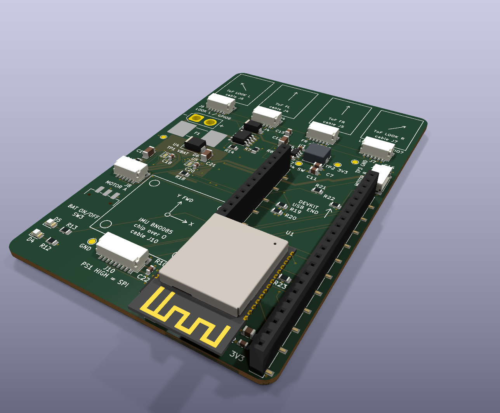
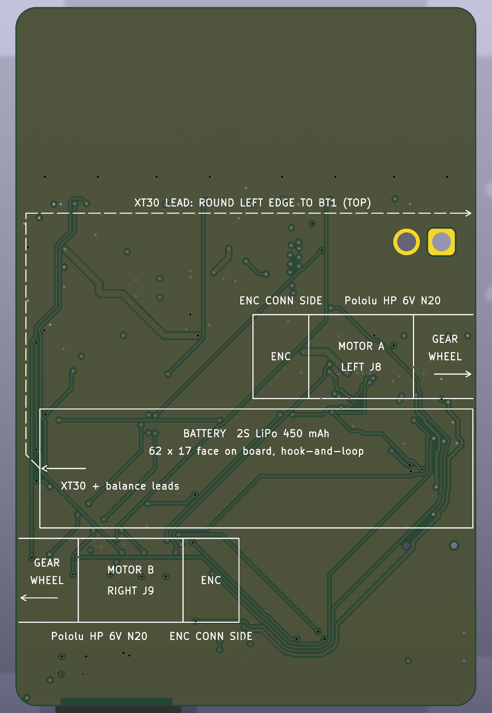
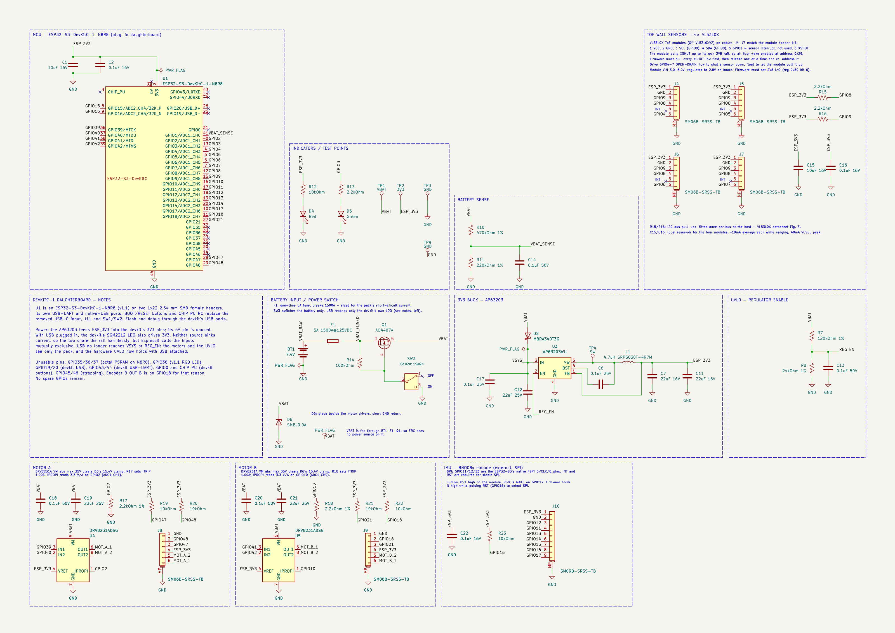
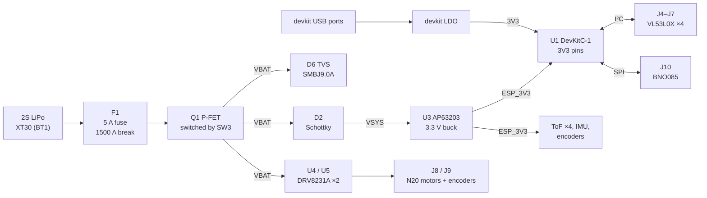
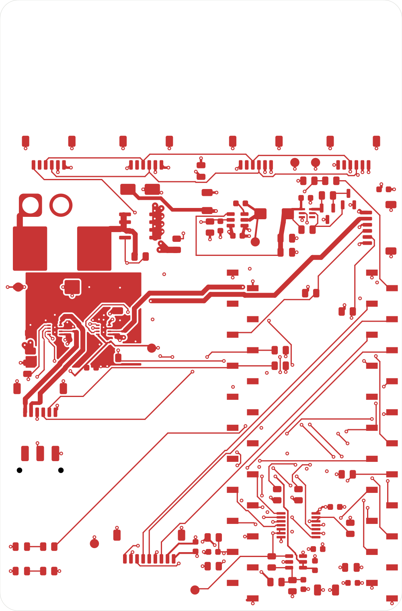

# Pixy-M2 — Micromouse Controller PCB

A controller for a micromouse robot. **On this branch (`devkit-daughterboard`)
the MCU is an ESP32-S3-DevKitC-1-N8R8 plugged into two SMD female headers.**
The board carries two **DRV8231A** motor drivers with current regulation, a
**2S LiPo** power path with fusing, switching and UVLO, a **3.3 V buck**, and
connectors for four **VL53L0X** time-of-flight wall sensors, a **BNO085** IMU
and two **Pololu N20** gearmotors with encoders.

Designed in **KiCad 10**. 4-layer, 66 × 100 mm, fully placed and routed.

<p align="center">
  
</p>

| | |
|---|---|
| **MCU** | ESP32-S3-DevKitC-1-**N8R8** (v1.1; 8 MB flash, 8 MB octal PSRAM) on two 1×22 SMD female headers. USB-UART and native-USB ports, BOOT/RESET on the devkit |
| **Power in** | 2S LiPo (7.4 V nominal, 8.4 V full) via XT30. The devkit's USB powers the 3.3 V rail on the bench |
| **Logic rail** | 3.3 V, AP63203 2 A synchronous buck |
| **Motor drive** | 2 × TI DRV8231A H-bridge, 1.00 A hardware current limit, per-motor current sense into the ADC |
| **Sensors** | 4 × VL53L0X ToF (I²C), BNO085 9-DoF IMU (SPI), 2 × 12 CPR quadrature encoders |
| **Protection** | 1500 A-breaking battery fuse, 600 W TVS on the motor rail, hardware UVLO (the devkit carries its own USB protection) |
| **PCB** | 66 × 100 mm, 4 layers, 1.6 mm, 57 footprints, 192 vias, ~2.0 m of track |
| **Status** | Schematic complete, ERC 0/0. Layout routed, DRC 0 violations / 0 unconnected / 0 parity. **Not yet fabricated.** |

---

## Contents

- [Board renders](#board-renders)
- [Schematic](#schematic)
- [System architecture](#system-architecture)
- [Design decisions](#design-decisions)
- [Pin and connector reference](#pin-and-connector-reference)
- [PCB layout](#pcb-layout)
- [Parts list](#parts-list)
- [Repository layout](#repository-layout)
- [Working with the project](#working-with-the-project)
- [Bring-up notes for firmware](#bring-up-notes-for-firmware)
- [Status and open items](#status-and-open-items)
- [License](#license)

---

## Board renders

The top of each image is the **front** of the robot: the four ToF sensor
mounts face the maze walls ahead. The devkit stands on its sockets along the
right edge with its antenna over the rear edge. The devkit has no 3D model, so
the renders show Espressif's WROOM-1 model at the module's real height
(11.6 mm) with nothing under it: it floats above the sockets where the
devkit's own PCB would be.

<table>
  <tr>
    <td align="center"><br><b>Top</b></td>
    <td align="center"><br><b>Bottom</b> (mirrored)</td>
  </tr>
</table>

The silkscreen prints where each off-board part attaches:

- **Top:** the four ToF mounts with their aim arrows and the connector each
  cable plugs into, the BNO085 breakout outline (8.6 mm left of the rotation
  centre, beside the devkit), and an arrow between the socket rows toward the
  end that takes the devkit's USB ports.
- **Bottom:** the two Pololu HP 6V gearmotors, with the gearbox face on the
  board edge and the shaft on the wheel axle. `ENC CONN SIDE` marks the face
  their encoder boards stand proud of, which must point outboard. Between the
  motors is the 2S battery's outline, with an arrow at the end its leads
  leave from and a dashed line for the lead's route round the left edge to
  BT1.

---

## Schematic

Single flat A3 sheet: [`Pixy-M2.kicad_sch`](Pixy-M2.kicad_sch).

[](docs/images/schematic.png)

---

## System architecture



### Power path

```
 BT1+ ── F1 ── VBAT_FUSED ── Q1 (S→D) ── VBAT ──┬── D2 ── VSYS ── U3 buck ── ESP_3V3 ── devkit 3V3 pins
                   │            │                ├── U4/U5 motor drivers
                  R14           G                ├── R7/R8 UVLO divider
                   └────────────┤                ├── R10/R11 battery sense
                           SW3 (gate only)       └── D6 TVS to GND
```

- **`VBAT`** is the switched, fused motor rail. Motor current does **not** pass
  through D2. D2 feeds only the buck input.
- **`VSYS`** is the pack through D2, **~8.1 V** on a full pack.
- **`ESP_3V3`** feeds the devkit through its 3V3 pins (a supply option
  Espressif's user guide lists), the four ToF sensors, the IMU, the encoders,
  the LEDs and the drivers' `VREF` pins. The devkit's 5V pin is unused.
- **USB on the devkit runs the logic** with SW3 off: the devkit's own 800 mA
  LDO then drives the 3.3 V rail, and the motors stay unpowered. With USB and
  the pack both on, the LDO and the buck share the rail. Neither can sink
  current, so that is harmless, but Espressif calls the supply options mutually
  exclusive. There is no on-board charger; charge the pack separately.

---

## Design decisions

The rules and rejected alternatives that must not regress are summarised in
[`CLAUDE.md`](CLAUDE.md). The measurements behind each change are under
[`layout/`](layout/), and the full history is in the git log. This section
covers the main choices.

### The MCU as a plug-in DevKitC-1 (this branch)

The ESP32-S3 is an off-the-shelf **ESP32-S3-DevKitC-1-N8R8** on two 1×22
female headers, not a soldered WROOM module. The devkit brings its USB ports,
its USB-UART bridge with auto-reset, its BOOT/RESET buttons and its CHIP_PU RC.
That takes the USB-C input, its ESD array and PPTC, the CC and shield parts,
the USB supply path into VSYS, the reset/boot network and the programming
header off this board, along with the routed USB pair and its impedance
question.

- **Placement.** The devkit is 25.4 × 62.7 mm and fits only along the right
  edge, antenna over the rear edge as before. The board outline is unchanged
  at 66 × 100 mm. The left corner stays the motor and power region; the IMU
  moves into the 25 mm column left beside the devkit, 8.6 mm off the rotation
  centre.
- **SMD sockets.** The devkit's area lies over the underside battery bay and
  motor B; through-hole socket tails would stand into both.
- **Power.** The board's AP63203 feeds the devkit's 3V3 pins, so the verified
  buck block stays. The alternative, a 5 V buck into the devkit's 5V pin,
  would have OR-ed cleanly with USB through the devkit's diodes, but it meant
  redesigning the buck and running everything from an 800 mA LDO.
- **Pins.** The N8R8's octal PSRAM takes GPIO35–37 and the v1.1 board's RGB LED
  takes GPIO38. Encoder B's OUT B moved from GPIO38 to GPIO18, the last spare.
  No GPIO is left spare.
- **Costs.** About 10 mm more height, the devkit's mass, and friction-fit
  headers in a robot that hits walls: retain the devkit before running.

An earlier version put the motors, drivers and IMU on a daughterboard instead,
through two 22-pin headers. That one carried motor return current through the
headers; this one keeps all the power and motor copper on the main board.

### Motor driver: TI DRV8231A

The driver has to survive what the TVS lets through, not just the 8.4 V pack.
D6 clamps `VBAT` at up to **15.4 V**, and that ruled out the usual micromouse
parts:

| Part | VM abs max | Verdict |
|---|---:|---|
| DRV8833 | 11.8 V | below the clamp: rejected |
| TB6612FNG | 15.0 V | below the clamp: rejected |
| DRV8874 / DRV8876 | 40 V | good, but no stock KiCad symbol |
| **DRV8231A** | **35 V** | **fitted**, 2.3× the clamp |

The DRV8231A also:

- runs down to **4.5 V**, which covers the whole usable pack range;
- has **internal 100 kΩ pulldowns on IN1/IN2**, so both motors stay off while
  the ESP32's GPIOs float at reset;
- needs no nSLEEP or nFAULT pin, which saves GPIOs;
- has **integrated current regulation and an `IPROPI` sense output**.

### Current limit: 1.00 A, set by the connector

```
ITRIP = VREF / (AIPROPI × RIPROPI) = 3.3 V / (1500 µA/A × 2.2 kΩ) = 1.00 A
```

J8/J9 use JST SH connectors so Pololu's own encoder cable plugs in 1:1. SH
contacts and that cable are rated **1 A**, so R17/R18 hold the limit there.
The limit still gives ~63 % of the motor's 6 V stall torque. It also bounds the
driver's dissipation: an unregulated stall at 8.4 V would draw ~1.9 A and put
the 2 × 2 mm WSON into thermal shutdown. `IPROPI` reads 3.3 V/A on an ADC1 pin
for each motor, so firmware can detect a stall and cut drive long before the
fuse matters.

### Battery fuse: one-time, 1500 A breaking

The chosen pack is a 2S 450 mAh 100C LiPo. Its estimated dead-short current is
**200–400 A**. The original 3 A PPTC could only break 40 A, so it was replaced
with a **Littelfuse 0885005.DR**: 5 A fast-acting, 1500 A breaking at
125 VDC. Normal worst-case load is ~2.4 A: both motors at the limit plus the
buck. Slow overload protection is now the job of the driver current limit and
firmware stall detection. F1 only opens on a real fault.

### Hardware undervoltage lockout

The buck's `EN` pin has a built-in comparator with switched hysteresis. A 1 %
divider (R7/R8) on `VBAT` sets it to:

| | Pack voltage | Per cell |
|---|---:|---:|
| Turn on | 6.90 V | 3.45 V |
| Turn off | 5.94 V | 2.97 V |

USB no longer reaches `EN` (the old `VBUS` → D3 → R9 path left with the
on-board USB), so the UVLO holds with the devkit's USB plugged in. Firmware
still does the accurate low-voltage cutoff; the hardware UVLO is the backstop
for when firmware is not running.

### Battery sense without a gate FET

`VBAT` → 470 kΩ / 220 kΩ → GPIO1 (ADC1_CH0), with a 100 nF reservoir cap.

- The divider draws 12 µA, well under the 58 µA of the UVLO divider, which
  cannot be gated. A gate FET would save almost nothing.
- A low-side gate would have been harmful: the sense node floats up into the
  GPIO clamp.
- A full-pack reading sits at 2.68 V. Even a badly overcharged 9.5 V pack reads
  3.03 V, still inside the ADC's range.
- Both dividers are downstream of Q1, so SW3 OFF removes their drain on the
  pack.

### Buck converter

- The **AP63203WU** is a fixed 3.3 V part, so it needs no feedback divider.
- **L1 is a Bourns SRP5030T-4R7M** (Isat 6 A, 53 mΩ). It replaced an 0805
  inductor that would have saturated at a few hundred mA.
- **C17 straddles the package under U3**, across IN and GND, which is the
  tightest input loop the pinout allows. C12 (22 µF 25 V 1206) is the bulk. It
  keeps ~11–13 µF at 8.4 V bias, which meets the datasheet's 10 µF effective
  input capacitance.
- **The switch node is 3.57 mm² of top copper with no vias.** TP4 hangs off it
  as a short stub.

### Input diode

D2 is an **onsemi MBRA340T3G** (40 V, 3 A, SMA). It carries only the buck's
input, ~0.43 A worst case, so an ideal-diode controller is not worth it. The
40 V rating covers the 15.4 V TVS clamp reaching `VSYS`. It also blocks the
devkit's USB from back-feeding `VBAT` through the buck.

### IMU on SPI, not I²C

The BNO085 could have shared the ToF I²C bus on throughput alone. It was put
on its own SPI bus for **latency**: an IMU interrupt that arrives mid-way
through a ToF read would wait up to ~150 µs, which is 15 % of a 1 kHz control
period. SCK, MOSI and MISO are on the ESP32-S3's native FSPI pins, so they go
through the IO MUX rather than the GPIO matrix. INT and RST are wired because
the BNO08x needs both for stable SPI. WAKE shares a pin with PS0 on the module.

### Four ToF sensors on one I²C bus

Every VL53L0X powers up at address `0x29`, and the address is volatile. Each
sensor therefore gets its own XSHUT line (GPIO4–7), so firmware can release the
sensors one at a time and re-address them. R15/R16 (2.2 kΩ) are the only bus
pull-ups, placed near the host, as the datasheet recommends. J4–J7 use the
GY-VL53L0XV2 module's own header order, so the cable is a straight 1:1 loom.

### USB

On the devkit. Its native-USB port (USB-Serial-JTAG) gives flashing, console
and debugging; its USB-UART port gives esptool auto-reset. Each port reaches
the devkit's 5 V rail through a 1N5819, and the board does not use that rail.

### Strapping pins

GPIO45 and GPIO46 carry explicit no-connect flags. Driving GPIO45 high at reset
sets the flash rail to 1.8 V and the board will not boot. GPIO46 high with
GPIO0 low is an invalid boot combination. GPIO0 is the devkit's BOOT button.
GPIO3 is the safe one of the four, and drives the green status LED
active-high, so its reset state stays low.

### Capacitor ratings

Every capacitor's voltage rating is in its Value field, so it shows on the
schematic. One is worth pointing out:

- **C19/C21** (motor bulk) are **22 µF 25 V** because of the 15.4 V TVS clamp.

---

## Pin and connector reference

### GPIO allocation

Every GPIO the devkit leaves usable is allocated; none is spare.

| Function | GPIO |
|---|---|
| Devkit USB D− / D+ (not wired here) | 19 / 20 |
| Devkit BOOT button (not wired here) | 0 |
| Battery sense (ADC1_CH0) | 1 |
| Status LED (green, active high) | 3 |
| ToF XSHUT 1–4 (J4–J7) | 4, 5, 6, 7 |
| I²C SDA / SCL (ToF bus) | 8 / 9 |
| Motor A IN1 / IN2 | 39 / 40 |
| Motor B IN1 / IN2 | 41 / 42 |
| Motor A / B current sense (IPROPI, ADC1) | 2 / 10 |
| Encoder A: OUT A / OUT B | 47 / 48 |
| Encoder B: OUT A / OUT B | 21 / 18 |
| IMU SPI SCK / MOSI / MISO / CS | 12 / 11 / 13 / 14 |
| IMU INT / RST / WAKE (PS0) | 15 / 16 / 17 |
| Devkit USB-UART TX / RX (not wired here) | 43 / 44 |
| N8R8 octal PSRAM / v1.1 RGB LED (not wired here) | 35, 36, 37 / 38 |
| Strapping, deliberately no-connect | 45, 46 |

### Connectors

All the signal connectors are **JST SH 1.0 mm side-entry**.

**J4–J7: VL53L0X ToF sensors** (`SM06B-SRSS-TB`, GY-VL53L0XV2 header order)

| Pin | 1 | 2 | 3 | 4 | 5 | 6 |
|---|---|---|---|---|---|---|
| Signal | **VCC 3.3 V** | GND | SCL | SDA | INT (NC) | XSHUT |

> ⚠️ Pin 1 is **VCC**, not GND. A cable built "the usual way round" puts
> 3.3 V on the sensor's ground.

| Connector | Position | XSHUT |
|---|---|---|
| J4 | Front left (FL) | GPIO4 |
| J5 | Front right (FR) | GPIO5 |
| J6 | Look-ahead left, 45° | GPIO6 |
| J7 | Look-ahead right, 45° | GPIO7 |

**J8 / J9: motor + encoder** (`SM06B-SRSS-TB`, Pololu 12 CPR encoder order)

| Pin | 1 | 2 | 3 | 4 | 5 | 6 | MP |
|---|---|---|---|---|---|---|---|
| Signal | GND | OUT B | OUT A | VCC 3.3 V | M2 | M1 | GND |
| Pololu wire | green | white | yellow | blue | black | red | — |

J8 is motor A (left) and J9 is motor B (right). Use Pololu's straight SH–SH
encoder cable (#4765–#4769). R19–R22 pull the encoder outputs up to 3.3 V.

**J10: BNO085 IMU** (`SM09B-SRSS-TB`)

| Pin | 1 | 2 | 3 | 4 | 5 | 6 | 7 | 8 | 9 |
|---|---|---|---|---|---|---|---|---|---|
| Signal | VIN 3.3 V | GND | SCK | MOSI | MISO | CS | INT | RST | WAKE / PS0 |

> ⚠️ Jumper **PS1 high** on the module. Stock BNO08x breakouts ship in I²C mode
> and will not answer on SPI until it is changed.

**U1: the DevKitC-1** (two 1×22 2.54 mm SMD female headers)

The devkit plugs in with its **USB ports toward the front** of the robot: the
silkscreen arrow between the rows points that way, and `3V3`/`GND` mark pins
1/44 at the antenna end. Turned round, it puts the 3.3 V rail on GND pins.
Its USB-UART port is the way back in if firmware ever disables the native USB.

**Other**

| Ref | Part | Purpose |
|---|---|---|
| BT1 | XT30U-M | 2S LiPo input |
| SW3 | C&K JS102011SAQN slide | Battery ON/OFF (gate control only) |
| D4 / D5 | Red / green LED | Power (always on) / status (GPIO3), rear-left corner |
| TP1–TP4 | Test pads | VBAT, 3V3, GND, SW node (TP4 is under the devkit's USB end) |
| TP9 | Test pad | Probe GND |

---

## PCB layout

### Stackup

4 layers, 1.6 mm, designed for **JLC04161H-7628** (~0.2 mm L1–L2 prepreg).

| Layer | Use |
|---|---|
| **L1** F.Cu | Components, buck switch node, motor-driver power loops, ground pour around the motor region |
| **L2** In1.Cu | **Solid, unbroken GND plane.** No signals, no splits. |
| **L3** In2.Cu | `ESP_3V3` pour plus a separate `VBAT` island under the motor region |
| **L4** B.Cu | Secondary routing plus a GND pour stitched to L2 |

The ground plane is never split. Noise is controlled by **placement**
instead. The motor drivers, the bulk capacitors, D6 and the battery entry
share the left-hand region. The devkit, ADC nodes and I²C sit away from it.

<p align="center">
  <br>
  <em>Top copper (F.Cu). The 0.8 mm motor trunks, the 1.0 mm battery path and the motor-region ground pour are on the left.</em>
</p>

### Layout highlights

- **Motor outputs** are 0.8 mm trunks. The only narrower copper is inside
  each driver's own pin field, and a custom DRC rule enforces that. Each pair
  runs together to its connector: the loop areas are **26.4 mm²** (A) and
  **27.8 mm²** (B).
- **Driver thermal pads** each have two filled-and-capped in-pad vias
  (IPC-4761 type VII) plus four more nearby. Only two fit a 0.9 × 1.6 mm pad
  under the hole-to-hole rule.
- **VM bypass caps** sit 1.33 mm from each driver's VM pin, across VM and GND.
  The loop closes in top copper with no plane hop.
- **Antenna keep-out**: the devkit's antenna overhangs the rear edge ~10 mm
  above the board, with an all-layer copper keep-out under its edge defined as
  a board rule area.
- **The devkit stands on SMD sockets.** Its courtyard is the two socket
  bodies; low parts (C1/C2, the I²C and encoder pull-ups) sit between the rows
  under it.
- **Rules are encoded, not just followed.** Netclasses and
  [`Pixy-M2.kicad_dru`](Pixy-M2.kicad_dru) enforce:
  - motor trunk width;
  - power and battery path widths;
  - a 0.2 mm signal floor;
  - clearance floors keeping `REG_EN`, `VBAT_SENSE` and the IPROPI lines away
    from motor and switching copper.

  Each rule was tested by breaking a copy of the board and checking that DRC
  fired.

The board was routed by a purpose-written A* grid router
([`tools/autoroute/`](tools/autoroute/)) and then reworked in stages, each
driven by a design review. Every stage is scripted and reproducible. The review
findings and the evidence for each fix (DRC reports, measurements,
before/after images) are under [`layout/`](layout/).

---

## Parts list

Parts for **one robot**, taken from **[`BOM.md`](BOM.md)**. BOM.md also has
each part's status, the cable wiring, the mechanical parts and the tools. The
shopping list below has one line per part to buy.

### Shopping list

Quantities are exact, with no spares except the crimp contacts. Where BOM.md
lets one part fill several positions, the list merges them: one 0.1 µF 50 V
part covers all nine 0.1 µF positions, and every resistor is bought at 1 %.
R7, R8, R10, R11 and R17/R18 must stay 1 %: they set the UVLO thresholds, the
battery-sense ratio and the motor current limit.

| Qty | Part | For |
|---:|---|---|
| 1 | Espressif **ESP32-S3-DevKitC-1-N8R8** (v1.1) | U1, plugged in. Not an `R8V`/`R16V` variant (1.8 V GPIO47/48) |
| 2 | 1×22 2.54 mm vertical **SMD** female header, Harwin M20-786 land pattern | U1's sockets. Part number open: see BOM.md |
| 2 | TI **DRV8231ADSGR** | U4, U5 |
| 1 | Diodes Inc **AP63203WU-7** | U3. Fixed 3.3 V, not the AP63200 |
| 1 | AOS **AO4407A** | Q1. Not the IRF7404 the symbol names |
| 1 | onsemi **MBRA340T3G** | D2 |
| 1 | Vishay **SMBJ9.0A-E3/52** | D6 |
| 1 | Red LED, high-efficiency, 0805 | D4. Must be visibly lit at ~150 µA |
| 1 | Green LED, 0805 | D5 |
| 1 | Bourns **SRP5030T-4R7M** | L1 |
| 1 | Littelfuse **0885005.DR** | F1 |
| 1 | C&K **JS102011SAQN** | SW3 |
| 1 | AMASS **XT30U-M** | BT1 |
| 6 | JST **SM06B-SRSS-TB(LF)(SN)** | J4–J9 |
| 1 | JST **SM09B-SRSS-TB(LF)(SN)** | J10 |
| 9 | 0.1 µF 50 V X7R, 0603 | C2, C6, C13, C14, C16–C18, C20, C22 |
| 2 | 10 µF 16 V X5R/X7R, 0805 | C1, C15 |
| 2 | 22 µF 16 V X5R/X7R, 0805 | C7, C11 |
| 3 | 22 µF 25 V X5R/X7R, 1206 | C12, C19, C21 |
| 6 | 10 kΩ 1 %, 0805 | R12, R19–R23 |
| 5 | 2.2 kΩ 1 %, 0805 | R13, R15–R18 |
| 1 | 24 kΩ 1 %, 0805 | R8 |
| 1 | 100 kΩ 1 %, 0805 | R14 |
| 1 | 120 kΩ 1 %, 0805 | R7 |
| 1 | 220 kΩ 1 %, 0805 | R11 |
| 1 | 470 kΩ 1 %, 0805 | R10 |
| 1 | 4-layer PCB, 1.6 mm, 66 × 100 mm | Order with the [fabrication options](#pcb-fabrication-options) below |
| 1 | SMT stencil | Optional, but hard to do without for the WSON parts |
| 4 | **GY-VL53L0XV2** ToF module (`HW-842`) | Wall sensors on J4–J7 |
| 1 | Adafruit **BNO085** breakout, #4754 | IMU on J10 |
| 2 | Pololu **Micro Metal Gearmotor HP 6V with 12 CPR encoder** (#5153–#5165) | J8, J9. Gear ratio not chosen yet; use the same for both |
| 2 | Pololu **JST SH encoder cable**, female–female (#4765–#4769, 10–63 cm) | Motors to J8, J9 |
| 1 | OVONIC **2S 450 mAh 100C LiPo, XT30** | BT1. The Amazon listing (B0D2KT723L) is a 4-pack |
| 4 | JST **SHR-06V-S-B** housing | Four ToF cables |
| 1 | JST **SHR-09V-S-B** housing | IMU cable |
| ~70 | JST **SSH-003T-P0.2-H** crimp contact | 33 are used; hand crimping wastes some |
| — | 28–32 AWG wire | ToF and IMU cables |

Not listed here:

- **Mechanical parts.** Wheels, motor brackets, drivetrain and sensor brackets
  are not designed yet.
- **Tools.** A 2S balance charger (XT30, JST-XH), a JST SH crimp tool, solder
  paste with hot air or reflow.

Both are in BOM.md, sections E and F.

### PCB fabrication options

- 4-layer, 1.6 mm, JLC04161H-7628 or equivalent.
- **Via fill and cap (IPC-4761 type VII)** for the four thermal vias under
  U4/U5. The requirement is noted on `Dwgs.User`. Tenting is not a substitute.

---

## Repository layout

```
Pixy-M2.kicad_pro / .kicad_sch / .kicad_pcb   KiCad 10 project
Pixy-M2.kicad_dru                             custom DRC rules
Pixy-M2.pretty/                               project footprint library (U1's DevKitC-1 sockets)
fp-lib-table                                  registers the project library
BOM.md                                        full bill of materials
CLAUDE.md                                     working notes: design invariants, rules and checks
REVIEW.md                                     layout design review
docs/images/                                  renders used in this README
layout/                                       placement notes, review evidence, DRC/ERC reports per fix
tools/autoroute/                              the grid router and scripted rework stages
tools/schematic/                              the sheet re-layout and devkit conversion scripts
tools/impedance/zdiff.py                      2-D field solver for the (main-branch) USB differential pair
DS_vl53l0x.pdf                                VL53L0X datasheet
```

`USB_C_Receptacle_Amazon.kicad_mod` in the root is **not used** by the board,
which has no USB connector on this branch.

---

## Working with the project

Open `Pixy-M2.kicad_pro` in **KiCad 10**. The project library `Pixy-M2.pretty`
is registered through `fp-lib-table`. The Espressif footprint library
(`PCM_Espressif`) is only needed for the 3D model the devkit footprint borrows,
and to compare U1's symbol against the library.

### Checks

```sh
# Electrical rules
kicad-cli sch erc -o erc.rpt Pixy-M2.kicad_sch

# Design rules, with zone refill and schematic parity
kicad-cli pcb drc --schematic-parity --refill-zones --format json -o drc.json Pixy-M2.kicad_pcb

# Netlist, to diff after any schematic edit
kicad-cli sch export netlist --format kicadsexpr -o after.net Pixy-M2.kicad_sch
```

Current results: **ERC 0 errors / 0 warnings; DRC 0 violations, 0 unconnected
items, 0 schematic-parity issues.**

Always refill zones before DRC. Without a refill, every plane-connected pad
shows up as unconnected.

### Things that will silently break the design

- **Do not "Update Symbols from Library" on U4/U5.** The stock
  `Driver_Motor:DRV8231ADSG` symbol types OUT2 as `power_in`. The copy cached in
  this schematic fixes it to `output`. Updating reverts the fix and brings back
  two ERC errors.
- **Do not "Update Footprint from Library" on U1** to `PCM_Espressif:ESP32-S3-DevKitC`.
  That one is through-hole, and its tails would stand into the underside
  battery bay and motor B.
- **Keep "Signal minimum width" as the first rule in `Pixy-M2.kicad_dru`.**
  When two rules set the same constraint, the later one wins. Moving this rule
  below the motor or power rules relaxes them to 0.2 mm.
- **Close KiCad before editing the files on disk.** A `~Pixy-M2.*.lck` file
  means the GUI has the project open, and whichever side saves last wins.

### Generating fabrication files

Gerbers, drill files and placement files are generated outputs and are
git-ignored. Export them from the PCB editor, or run:

```sh
kicad-cli pcb export gerbers -o gerbers/ Pixy-M2.kicad_pcb
kicad-cli pcb export drill   -o gerbers/ Pixy-M2.kicad_pcb
kicad-cli pcb export pos     -o gerbers/Pixy-M2-pos.csv Pixy-M2.kicad_pcb
```

---

## Bring-up notes for firmware

- **ToF sensors all wake at `0x29`.** GPIO4–7 float at reset and the modules
  pull XSHUT up, so all four sensors come up enabled at once. Firmware should
  first **drive all four XSHUT lines low**, then release one at a time and
  write a new address to register `0x8A`. The addresses are lost at every
  power cycle.
- **Drive XSHUT open-drain** (`GPIO_MODE_OUTPUT_OD`), not push-pull. The
  module's XSHUT sits on a 2.8 V rail.
- **Leave the VL53L0X driver's 2V8 I/O mode on.** It is the default in both ST's
  API and Pololu's library.
- **Motors sleep when IN1 = IN2 = 0.** The drivers' internal pulldowns keep
  them off until firmware drives the pins.
- **Cap motor PWM at ~71 % duty.** The N20s are 6 V motors on an 8.4 V pack;
  71 % gives a 6 V equivalent on a full pack.
- **Use IPROPI for stall detection** (GPIO2 / GPIO10, 3.3 V/A). The ADC clips
  at ~0.94 A, just under the 1.00 A limit, so a stall reads as full scale.
  IPROPI follows only the low-side FET current and switches off in coast
  (IN1 = IN2 = 0). Read it while driving or braking, and average over whole
  PWM periods.
- **Battery sense:** use `ADC_ATTEN_DB_12`. Scale by 690/220 and calibrate once
  against a meter reading at TP1. Allow ~50 ms after a step change (15 ms RC),
  and average over whole PWM periods.
- **The hardware UVLO now holds with USB connected** (USB no longer reaches
  `REG_EN`). Firmware should still cut off a low pack accurately.
- **The devkit's own LEDs:** its red power LED is always on (~0.3 mA, which now
  dominates deep sleep), and its RGB LED is on GPIO38. Leave GPIO38 unused, or
  drive the LED.
- **Keep ADC reads on ADC1.** Every analog input already is, because ADC2 is
  unusable while Wi-Fi is active.
- **Status LED:** drive GPIO3 **high** to light it.

---

## Status and open items

**Done:** schematic, placement, routing, the design-review rework, the DRC
rule set and the silkscreen assembly marks. On this branch (2026-10-13), U1
became a plug-in ESP32-S3-DevKitC-1-N8R8 on SMD sockets. That removed 21 parts
and re-routed the board at the same 66 × 100 mm outline
([`layout/devkit/`](layout/devkit/README.md)). The last two unmet layout rules
were closed on 2026-09-24:

- **R8 and C13 now sit beside U3's EN pin**
  ([`layout/reg-en/`](layout/reg-en/README.md)). No `REG_EN` copper is under
  U3 any more. Its closest approach to the switch node is U3's own 0.95 mm pin
  gap; it was 0.40 mm.
- **The IPROPI sense runs keep clear of motor copper**
  ([`layout/ipropi/`](layout/ipropi/README.md)). R17 and R18 moved to the far
  side of their driver's IN1/IN2 lines. GPIO2 and GPIO10 now come no closer
  than 1.30 mm and 0.80 mm to motor copper; they were 0.70 mm and 0.53 mm.

**Open before or during first fabrication:**

- [ ] **Mechanical design.** The drivetrain, wheel mounts and sensor brackets
      are not designed. The PCB has **no mounting holes** yet. The battery
      goes across the underside between the motors (2026-09-24), so the motor
      brackets may only fasten on the motors' outboard sides. The pack's lead
      needs about 13 cm to reach BT1; see `BOM.md`, "Battery".
- [ ] **Motor gear ratio.** Pick one for both motors. 12 CPR before gearing is
      low, so check that the ratio gives enough encoder edges for the control
      loop.
- [ ] **Current budget on real hardware.** Measure F1 temperature and U4/U5
      thermals during hard acceleration and stalls.
- [ ] **Socket part number.** Choose a 1×22 SMD female header that fits the
      Harwin M20-786 land pattern (or two 11-way strips per row).
- [ ] **Devkit retention.** Friction-fit headers in a robot that hits walls:
      add a strap or bracket once the mechanics are designed.
- [ ] **IPROPI readings on hardware.** The layout is done: the sense runs
      clear motor copper by 0.80 mm or more. Check the ADC reading and the
      1.00 A limit under PWM. If the limit trips early, TI's remedy is 10 nF
      on IPROPI, and an 0805 capacitor can be stacked on R17/R18.
- [ ] **Antenna performance** with the battery, motors and brackets fitted.

See [`CLAUDE.md`](CLAUDE.md) for the constraints behind each item, and
[`layout/`](layout/) and the git history for the measurements.

---

## License

The design files, scripts and documentation in this repository are released
under the [MIT License](LICENSE).

Third-party material keeps its own terms:

- `DS_vl53l0x.pdf` is STMicroelectronics' datasheet, included for reference.
- `Pixy-M2.pretty/ESP32-S3-WROOM-1_AntennaOverhang.kicad_mod` (unused on this
  branch) is derived from Espressif's KiCad footprint library and remains under
  that library's license. The DevKitC-1 footprint's 3D view borrows Espressif's
  WROOM-1 model by reference.
