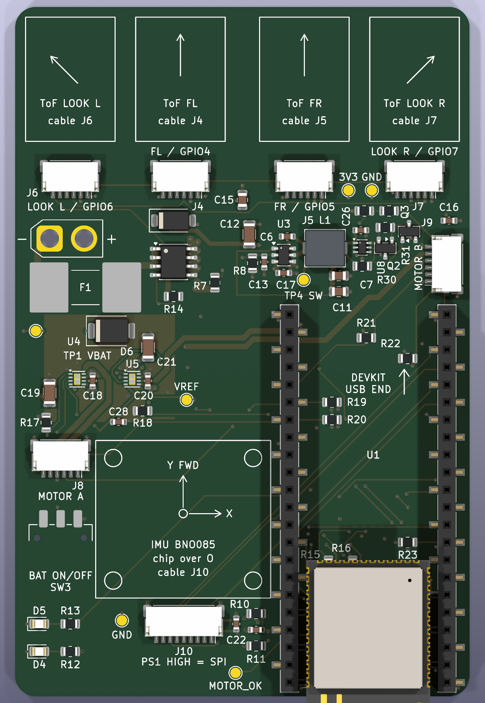
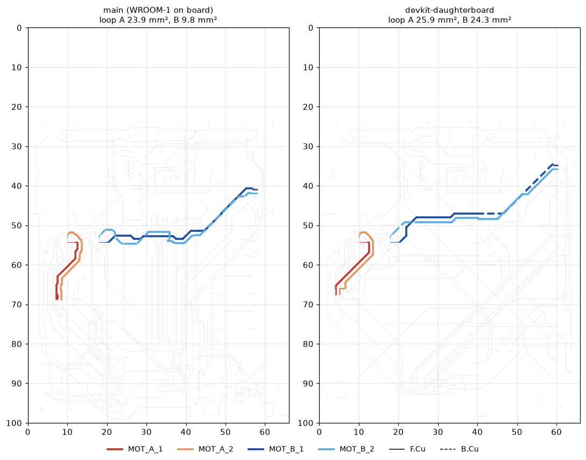

# U1 as a plug-in ESP32-S3-DevKitC-1-N8R8 — 2026-10-13

Branch `devkit-daughterboard`. U1 was a soldered ESP32-S3-WROOM-1-N16 with its
own USB-C input, USB ESD and supply path, BOOT/RESET buttons and a programming
header. It is now an Espressif ESP32-S3-DevKitC-1-N8R8 (v1.1) that plugs into
two 1×22 2.54 mm SMD female headers. The board outline is unchanged at
66 × 100 mm, so the mouse still fits the diagonal runs.

Three decisions came from the user:

- **The devkit is fed through its 3V3 pins from the AP63203.** Espressif's
  user guide lists "3V3 and G pins" as a supply option. The devkit's 5V pin is
  unused.
- **Every part the devkit duplicates is removed** (21 parts, listed below).
- **Encoder B OUT B moves from GPIO38 to GPIO18.** The v1.1 devkit drives its
  RGB LED from GPIO38. TP5, the old GPIO18 test point, went with it.

## What changed

### Schematic (`tools/schematic/devkit.py`)

- U1 becomes `PCM_Espressif:ESP32-S3-DevKitC` on the footprint
  `Pixy-M2:ESP32-S3-DevKitC-1_SMD_Sockets`. The symbol keeps its UUID, and
  Value, Footprint, Datasheet and MPN changed together.
- 13 no-connect flags on U1: 5V, CHIP_PU, GPIO0, GPIO19/20, GPIO43/44,
  GPIO35–38 and GPIO45/46. The devkit uses all of them itself.
- **21 parts removed:**
  - the USB-C input: J1, U2, F2, R1, R5, R6, C8;
  - the USB supply path: D1, D3, R9;
  - reset and boot: R2, C3, C4, C5, SW1, SW2;
  - the J11 programming header;
  - test points TP5–TP8.

  C1/C2 stay as the 3V3 bulk and decoupling at the devkit's 3V3 pins.
- The `GPIO38` labels at R22 and J9.2 become `GPIO18`.
- 59 nets (66 on main) and 57 parts. ERC 0 errors, 0 warnings.

### Footprint (`tools/autoroute/devkit_footprint.py`)

- **Pads.** Two copies of KiCad's `PinSocket_1x22_P2.54mm_Vertical_SMD_Pin1Left`
  (the Harwin M20-786 land pattern), 22.86 mm apart. Pads are numbered as
  Espressif's symbol: J1 is pads 1–22, J3 is pads 44 → 23.
- **SMD, not through-hole.** U1's area lies over the underside battery bay and
  motor B. Through-hole tails would stand into both.
- **The courtyard is the two socket bodies only.** The devkit stands about
  10 mm up (7.5 mm socket plus the 2.5 mm spacer of its own male headers), so
  low parts between and in front of the rows are legal.
- **Fab and silkscreen.** F.Fab draws the devkit outline, the antenna overhang
  and both USB ports. F.SilkS prints an arrow and `DEVKIT USB END` between the
  rows, plus `3V3`/`GND` at pins 1/44. A devkit plugged in turned round puts
  the 3V3 rail onto GND pins.
- **3D view.** Two socket models, plus Espressif's WROOM-1 model where the
  module sits on a fitted devkit (z = 11.6 mm). There is no DevKitC model, so
  nothing is drawn under the module and it floats above the sockets.

### Layout (`tools/autoroute/devkit.py`, rework stage 20)

**U1** is at KiCad (162.7, 157.98), rot 180.

- The socket rows are at board x 39.84 and 62.7. Pad 1 (3V3) is at the rear
  right, 0.265 mm clear of the R3 corner arc.
- The antenna end faces the rear edge, as the WROOM-1's did.
- The USB ports face the front at board y ≈ 36.5.
- At 25.4 × 62.7 mm the devkit fits nowhere else. The left corner is the motor
  and power region, and the middle is too narrow beside the IMU.

**Moves.** Board coordinates; each old position is asserted.

| Part | main | branch | Why |
|---|---|---|---|
| IMU reservation | x 20.5–45.5, y 53.5–78.5 | x 12.1–36.7, y 61–86 | the only 25 mm column left beside the devkit |
| J10 | (33, 50), rot 0 | (24.5, 89.5), rot 180 | behind the IMU, facing it. In front, it blocked U5's motor B exit and put the SPI bus beside motor copper |
| C22 | (24, 50) | (32.1, 89.5), rot 90 | beside J10.1/2 |
| J8 | (10, 65.5) | (6.6, 65.5) | 3.4 mm west, clear of the IMU reservation |
| SW3 | (7, 77) | (6.6, 77) | likewise |
| J9 | (60, 43.4), rot 90 | (62.3, 37.3), rot 90 | in front of the devkit, so the motor B trunks keep their old corridor |
| D4, D5, R12, R13 | x 53–58, y 53–57 | x 3.5–8, y 89.5–93.5 | rear-left corner, visible past the devkit |
| R10, C14, R11 | x 14–21, y 90–97 | x 35, y 88–92.7 | C14 hard against U1.41 (GPIO1) |
| C1, C2 | (46, 91), (45, 98) | (57.6, 92.9), (57.9, 95.44) | at the devkit's 3V3 pins, between the rows |
| R19, R20 | (17, 73), (17, 77) | (46, 57.34), (46, 59.88) | at their GPIO pins, between the rows |
| R23 | (43, 50) | (57, 77.66) | likewise |
| TP3 | (42, 44) | (54.5, 31.5) | GND probe point beside the buck |
| TP9 | (18, 89) | (15.5, 89) | clear of J10 |

**Outline and keep-outs.**

- J1's footprint held the notch in the rear edge, so its removal left the
  outline open. A straight Edge.Cuts line now closes it (board x 47.3–60.7,
  y 100).
- The antenna copper keep-out moves to x 43.5–59.5, y ≥ 98.8, all layers. It
  is the module's footprint, where it overhangs the board.

**Routing.** The stage rips every net that ran to the old module or to a moved
part. It keeps the hand-placed copper inside the motor corner (driver pin
escapes, the IPROPI runs, VREF), the buck block, FB and REG_EN. It then
re-routes in this order:

1. **Both motor pairs.**
   - J8's stubs fan in north, under its own housing. At J8's new x the old
     corridor along the board edge is gone.
   - MOT_B_1 follows layer-pinned waypoints that pass 5 mm south of REG_EN
     and cross under the left socket on B.Cu. MOT_B_2 pairs with it.
2. **The plane pins that need their spot first:** C22, J10 and J8.
3. **Every signal, in a fixed order,** with the custom clearance floors given
   to A*: IPROPI 0.75 mm from motor copper; REG_EN and VBAT_SENSE 5 mm. Signal
   vias stay 1.35 mm apart. No 3V3 via goes over the In2 VBAT island.
4. **The plane taps and dead-end pruning.** `prune_strict()` removes dead ends
   the way KiCad's `track_dangling` check sees them. `drop_via_only_gnd()`
   removes F.Cu GND stubs that reach no pad. Those are the leftovers of J1's
   A1/B12 pads and TP3's old position, which DRC does not flag: their ends
   meet each other or a via.
5. **One GND via in each piece of the B.Cu pour that has none.** Long B.Cu
   runs cut the pour into pieces, and island removal would drop each one.

**Rules.**

- `Pixy-M2.kicad_dru` loses the USB rules.
- "Hole clearance" (0.30 mm) now applies everywhere. Its old condition
  exempted J1's pads from J1's own locating holes.
- The USB netclass is gone, and `Power` keeps only `/VSYS`.

## Verification

    kicad-cli sch erc -o /tmp/erc.rpt Pixy-M2.kicad_sch
    kicad-cli pcb drc --schematic-parity --refill-zones --save-board --format json -o /tmp/drc.json Pixy-M2.kicad_pcb
    /usr/bin/python3 tools/autoroute/via_openings.py Pixy-M2.kicad_pcb --output /tmp/apertures.json

| Check | Result |
|---|---|
| ERC | 0 errors, 0 warnings |
| DRC | 0 violations, 0 unconnected, 0 schematic parity |
| Aperture audit | 192 vias, 4 thermal, 0 violations; nearest ordinary drill 0.10 mm from an opening |
| Full replay (`rework.py`) | reproduces the committed board |

**`via_openings.py` under KiCad 10.0.6 and Python 3.14.** The SWIG iterator
there has no `.next` method, so the audit crashed even on main's board. A
three-line shim aliases it to `__next__`.

## Measurements (`measure.py`, `measure.json`)

    python3 layout/devkit/measure.py BEFORE.kicad_pcb AFTER.kicad_pcb [--json OUT]

Clearances come from DRC descent (`layout/issue8-rules/clearmin.py`) and loop
areas from `tools/autoroute/loop.py`. The branch column is the board after
stage 21 straightened the copper (`layout/octilinear/`).

| | main | branch |
|---|---:|---:|
| Footprints | 78 | 57 |
| Vias (GND / 3V3 / VBAT / signal) | 254 (89 / 28 / 24 / 113) | 192 (72 / 27 / 24 / 69) |
| Track, F.Cu + B.Cu | 2396 mm | 1968 mm |
| REG_EN to SW/BST | 0.95 mm | 0.95 mm (U3's own pin gap) |
| REG_EN to motor copper | 7.75 mm | 8.0 mm |
| VBAT_SENSE to SW/BST and motor copper | > 20 mm | > 20 mm |
| IPROPI to motor copper | 0.80 mm | 0.80 mm (GPIO10's escape via, unchanged) |
| Motor A loop | 23.9 mm² | 25.9 mm² |
| Motor B loop | 9.8 mm² | 24.3 mm² |
| IMU chip from the rotation centre | 0 | 8.6 mm left, 7.5 mm behind (11.4 mm) |

**Motor B's loop grew.** `loop.py` takes the signed area of the closed
M1 → connector → M2 path. Where the pair crosses itself, the lobes either side
have opposite sign and cancel, as their far fields do. `measure.py` splits
each loop by winding number:

| Motor B | lobes | signed (`loop.py`) | enclosed |
|---|---|---:|---:|
| main | 25.9 and 16.1 mm², opposite sign | 9.8 mm² | 42.1 mm² |
| branch | 38.2 and 14.0 mm², opposite sign | 24.3 mm² | 52.2 mm² |

- **The pair is as long as before**, about 50 mm from U5 to J9. J9 kept its
  corner of the board.
- **Main's 9.8 mm² came mostly from two lobes that almost balanced.** On the
  branch the lobes are unequal, and the pair encloses 24 % more copper area.
- **24.3 mm² is close to motor A's loop.** Both are small next to the motor
  cables themselves. Tightening it would mean re-pairing the trunk by hand
  along the whole run.

Motor A's pair never crosses, so its signed and enclosed areas are the same.

**Motor A's loop** grew by 2.0 mm² when J8 moved 3.4 mm west and its stubs
started fanning in under the housing.

## Not checked by DRC

- **The devkit's USB ports** sit at the front end, about 10 mm up, over the
  buck block. A cable plugs in from the front over the J5/J7 ToF connectors.
  Check that it clears the ToF brackets once they are designed.
- **J9's housing** sits partly under the devkit's front edge. It is a
  side-entry SH connector, well under the 10 mm clearance, and its cable
  leaves sideways toward motor B.
- **Parts under the devkit**, all far below the ~8 mm limit:
  - between the rows: R15, R16, R19–R23, C1 and C2 (0603/0805);
  - under its USB end: the buck's C7, C11, C17, TP4 and U3's pin-4 corner
    (TSOT-23-6).

  None of them is reachable once the devkit is fitted, TP4 included. TP2 (3V3)
  and TP3 (GND) stay outside the outline.
- **The IMU is no longer at the rotation centre.** That does not matter for
  the gyro. The accelerometer sees centripetal acceleration in turns, about
  ω²·11.4 mm.
- **Socket part number.** The land pattern is the Harwin M20-786's, but no
  22-way M20-786 part number was confirmed. Two 11-way strips per row fit the
  same pads.
