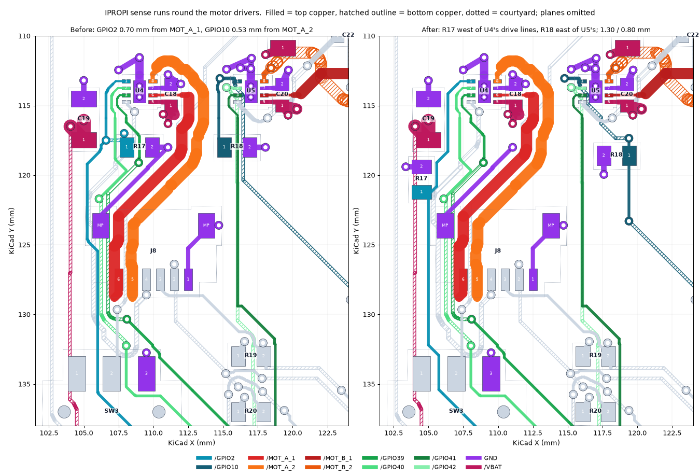
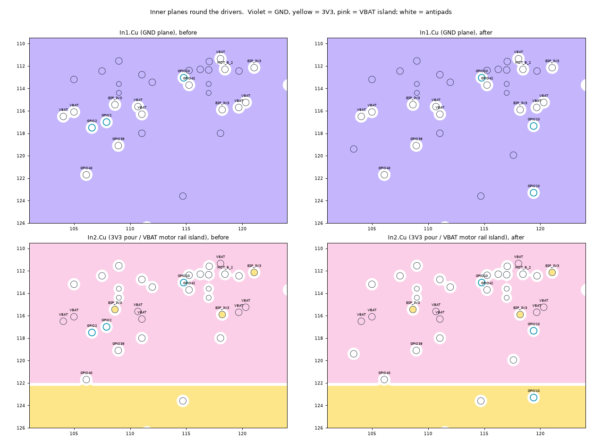

# IPROPI sense runs clear of motor copper — 2026-09-24

The next open item in the README after REG_EN: "IPROPI traces pass 0.53 mm from
motor copper. Validate on hardware." GPIO2 and GPIO10 carry each DRV8231A's
IPROPI output, 1500 µA/A into R17/R18 (2.2 kΩ), to the ADC. CLAUDE.md's rule
was to keep them short and away from the motor outputs. REVIEW.md added that
they "run alongside drive-control signals", and asked for better isolation
"where convenient".

Two placement choices had defeated the rule:

- **R17 sat on the wrong side of U4's drive lines.** U4's IN1/IN2 (GPIO39/40)
  leave the pins beside IPROPI. R17 sat east of them, so GPIO2 hopped over
  them on B.Cu, over the In2 VBAT island. GPIO39 then threaded between R17's
  own pads. Further down, GPIO2 ran 0.70 mm from the MOT_A_1 trunk beside J8,
  and 0.23 mm from SW3's gate pad.
- **R18 sat on the wrong side of U5's drive lines.** U5's IN1/IN2 run
  stacked, GPIO41 on F.Cu over GPIO42 on B.Cu, at x ≈ 116 for 15 mm. R18 sat
  west of them. GPIO10 reached it down the channel beside U4's MOT_A_2 loop,
  0.53 mm away. It then crossed the pair under U5 and ran 8 mm beside GPIO42
  on B.Cu, 0.25 mm away, over the VBAT island.

## What changed (`tools/autoroute/ipropi.py`)

The stage runs in `rework.py` after `reg_en.py`. Standalone, it converts an
existing board once, and it asserts what it replaces. It changes GPIO2,
GPIO10, and the GND stubs of R17 and R18. No other copper moves.

- **Motor A needs no crossing.** The three nets leave U4 west in the order
  they reach U1's west column: IPROPI outermost, then IN2, then IN1. Only R17's
  old position forced GPIO2 across the drive lines.
  - R17 moves to (104.5, 120.3), rot 90, west of the escapes. Its GPIO2 pad
    is to the south. Its GND via is at (103.375, 119.4), 0.275 mm from GPIO6
    and from the VBAT feed, both on B.Cu.
  - GPIO2 runs down between C19 and the escapes. Once past C19 it steps
    onto R17's east side, 1.45 mm from GPIO40. It goes through R17 and on
    down x = 105, 1.7 mm from MOT_A_1, then centred between SW3's pads to
    its old run to U1.
  - GPIO2 has no via left, and no copper over the VBAT island.
- **Motor B crosses once, at the pins.** GPIO10 lands on U1's bottom row,
  east of where GPIO41/42 land, so it has to cross them.
  - It keeps its escape via and its B.Cu crossing under U5's pins. There the
    pair is still two F.Cu pin escapes, and the proximity is set by the
    0.5 mm pin pitch.
  - It then leaves east at once, 45° away from GPIO42.
  - It rises at (119.4, 117.35) to R18. R18 moves to (118.5, 118.6), rot 180,
    east of the pair, with its GND pad toward the pair.
  - From R18 it drops on F.Cu to (119.4, 123.3), just past the island. There
    it rejoins its old B.Cu diagonal to U1.
  - The channel beside MOT_A_2 is now empty.
- **Labels.** C19's reference field moves west of C19, because it sat where
  R17 now is.

### Why not A*

The first attempt fattened motor and drive copper in the router's obstacle
map and let A* reconnect both nets. GPIO2 found no path out of U4's pin
field. GPIO10 swung west across J8 and through the encoder pull-ups, which
was longer and worse. Both runs are hand-placed instead, and DRC checks
every coordinate.

## Measurements (`measure.py`, `measurements.json`, `clearances.json`)

    python3 layout/ipropi/measure.py BEFORE.kicad_pcb AFTER.kicad_pcb [--json OUT]

Nearest copper, by exact DRC descent:

| | before | after |
|---|---:|---:|
| GPIO2 to motor copper | **0.70 mm** (the J8 run, MOT_A_1) | **1.30 mm** (U4's own pin 1 to pin 8) |
| GPIO10 to motor copper | **0.53 mm** (the descent, MOT_A_2) | **0.80 mm** (its escape via, MOT_A_2) |
| GPIO2 to GPIO39/40 | 0.20 mm | 0.25 mm (U4's pin pitch) |
| GPIO10 to GPIO41/42 | 0.21 mm | 0.21 mm (unchanged: two escape vias beside U5) |

Nearest pairs that no layout can move:

- **1.30 mm is U4's pin 1 to pin 8.** IPROPI and OUT2 sit opposite each other
  across the WSON.
- **0.80 mm is GPIO10's escape via.** It is boxed in by one of U5's
  heat-spreading GND vias and by GPIO42's via. Moving it means moving a
  thermal via.
- **Every other stretch of both runs is at least 1.0 mm from motor copper.**
  That is the new DRC floor's basis.

Exposure, as track length within a band of the aggressor copper:

| | before | after |
|---|---:|---:|
| GPIO2 within 1 / 2 mm of motor copper | 4.5 / 9.6 mm | **0 / 6.2 mm** |
| GPIO10 within 1 / 2 mm of motor copper | 4.4 / 6.6 mm | **0 / 1.9 mm** |
| GPIO2 within 0.6 / 1 / 2 mm of GPIO39/40 | 6.8 / 8.9 / 23.5 mm | **3.7** / 8.9 / **15.6** mm |
| GPIO10 within 0.6 / 1 / 2 mm of GPIO41/42 | 13.7 / 14.9 / 17.7 mm | **5.6 / 6.1 / 8.0** mm |
| B.Cu over the In2 VBAT island, GPIO2 / GPIO10 | 1.8 / 10.9 mm | **0 / 7.4 mm** |
| vias, GPIO2 / GPIO10 | 2 / 2 | 0 / 4 |
| copper path U4.1 → U1.38 / U5.1 → U1.18 | 52.11 / 38.18 mm | 52.45 / 38.74 mm |
| copper path U4.1 → R17.1 / U5.1 → R18.1 | 8.10 / 6.38 mm | 10.32 / 9.97 mm |
| vias on the board | 253 | 254 |

- **Exposure is what crosstalk scales with.** A single minimum does not show
  it. Over a ground plane 0.2 mm below, coupling falls roughly as
  1/(1 + (s/h)²). So a run 2 mm away couples about 3 % as strongly as one
  0.3 mm away, and the bands above are where the coupling actually is.
- **What remains within 0.6 mm of a drive line is at the pins.** The 0.5 mm
  pin pitch puts IPROPI next to IN2, and each escape runs beside the IN2
  escape before they part: 3.7 mm for GPIO2, and 5.6 mm for GPIO10, which
  crosses the pair there. GPIO2 also runs 0.65 mm from GPIO40 for about 4 mm
  between C19 and the escapes. That channel is 1.25 mm wide, and C19's VBAT
  pad is on the other side.
- **Both runs to U1 are within 0.6 mm of their old length.** Each resistor
  moved 2–4 mm further along the run from its IPROPI pin, to about 10 mm of
  copper.

## Rule

"IPROPI clear of motor outputs" in `Pixy-M2.kicad_dru` goes from **0.25 mm
to 0.75 mm**, just under GPIO10's 0.80 mm escape via.

## Validation

- **DRC** (`drc.json`): `--schematic-parity --refill-zones` gives 0
  violations, 0 unconnected, 0 parity issues, with the new floor in place.
  The schematic is unchanged: R17 and R18 only move.
- **Aperture audit** (`aperture-audit.json`): passes with 254 vias and a
  0.10 mm minimum ordinary gap.
- **Exact clearances** (`clearances.json`): every other guarded pair is
  unchanged. The per-net pairs were measured as a separate rule set, because
  KiCad applies only the later of two rules that match the same pair. Two
  DRC measurements run at once gave a wrong empty result, so both boards
  were measured one after the other.
- **Negative tests** (`negative-tests.json`). The new floor fires:
  - on the board before this pass: eight pairs, 0.60–0.73 mm;
  - on a copy with GPIO10's old descent put back beside MOT_A_2: 0.50 mm.
- **Planes** (`planes.png`). Every new via's antipad is a separate hole in
  In1 and In2. GPIO2's two vias over the VBAT island are gone.
- **Nothing else moved.** A track/via diff against the previous board
  touches only `/GPIO2`, `/GPIO10` and the R17/R18 GND stubs.
- **Replay.** A full `rework.py` run from `base-routed.kicad_pcb` reproduces
  the board item for item. The exceptions are the silkscreen groups' random
  member UUIDs and one vertex of the B.Cu pour fill, whose area is identical
  (5281.036 mm²).

## What is still for hardware

The layout part of the item is done; the reading is not proven.

- **The part protects its own current limit against switching transients.**
  DRV8231A datasheet SLVSFZ8A, §7.4.2.2: the ITRIP comparator has a 1.4 µs
  blanking time and a 0.7 µs deglitch. Where transients outlast those, TI's
  remedy is **10 nF on IPROPI, close to the device**. A larger capacitor slows
  the regulation response.
  - R17/R18 run from IPROPI to GND, so an 0805 capacitor can be stacked on
    either 0805 resistor without a new footprint.
  - With 2.2 kΩ, 10 nF gives a 22 µs time constant, close to the part's 25 µs
    off time. Try it only if the limit chops early.
- **IPROPI reads nothing while the low-side FETs are off.** The same section
  says IPROPI follows only the low-side current, and it switches off with
  them. Firmware should read it while driving or braking, not in coast. It
  should also average over whole PWM periods.
- **Check on the assembled board:**
  - the ADC reading against a meter at a few steady currents;
  - the reading during PWM at the duty cycles firmware will use;
  - that the 1.00 A limit trips where it should, both motors running.

## Files

| file | content |
|---|---|
| `measure.py` | the measurements above, before vs after |
| `measurements.json` | its output for the previous and current board |
| `clearances.json` | `clearmin.py`, guarded and per-net pairs, before and after |
| `drc.json` | final DRC with schematic parity |
| `aperture-audit.json` | `via_openings.py` on the final board |
| `negative-tests.json` | the new floor, fired on two broken boards |
| `ipropi.png` | copper round the drivers, before and after |
| `planes.png` | In1 and In2 round the drivers, before and after |
