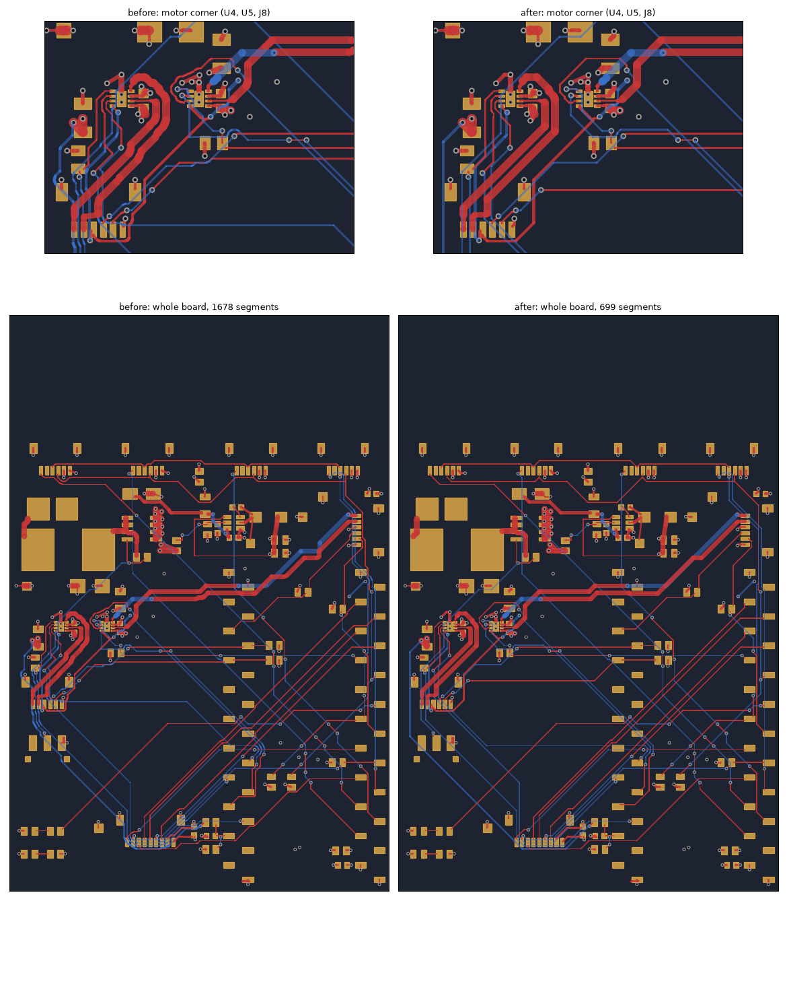

# Straight 0/45/90° runs in place of the router's staircases — 2026-10-13

Branch `devkit-daughterboard`. The user rejected the routed board on sight: the
motor trunks round U4/U5 and many signal runs looked curvy. The board had no
arcs at all. The A* router steps on a 0.05 mm grid in eight directions and pays
nothing for turning, so a run at any other angle comes out as a staircase. The
staircase alternates 45° and 90° steps of 0.05–0.3 mm, and at board scale it
renders as a curve. 1060 of the board's 1678 segments were such steps.

Rework stage 21 (`tools/autoroute/octilinear.py`) now rebuilds the routed
copper as straight legs at 0, 45 or 90° that turn in 45° steps.

## How it works

1. **Heal.** Many of the router's pieces meet only by overlapping, not at a
   shared endpoint. The `/MOT_A_2` hook at U4 was several such pieces.
   `_heal()` joins each loose end that lies inside another piece's copper to
   that piece exactly. It splits the host at the end's projection and adds a
   link no wider than either piece, so no copper moves.
2. **Chains.** Each net's copper on each layer is cut into chains between
   nodes: pads, vias, junctions of three or more segments and width changes.
3. **Simplify.** From each vertex, the next vertex is the farthest point along
   the chain that one leg reaches in the clear, or a 45° leg plus an
   orthogonal one. A 90° turn is taken only where it reaches clearly farther
   than any 45° option. Leftover 90° corners are then chamfered into two 45°
   turns where the chamfer fits.
4. **Accept** the new chain only if it has fewer segments or fewer sharp
   turns. Otherwise the old chain stays.
5. **Repeat** until a round changes nothing (4 rounds here). A pair at minimum
   spacing frees room for its partner only after it has moved itself: U4's
   inner trunk could straighten only after the outer one had.

**What "clear" means.** The test is the router's own raster: 0.26 mm plus half
the width from other copper, the board edge and keep-outs. Three tightenings
apply on top:

- **The custom floors.** `devkit.make_router` adds IPROPI 0.75 mm from motor
  copper, and REG_EN and VBAT_SENSE 5 mm.
- **Extra margin for new legs.** A new leg must clear by a further 0.02 mm.
  Between IPROPI and motor copper it needs 0.85 mm, so GPIO10 keeps its
  recorded 0.80 mm floor.
- **Motor pairs straighten together.** A motor output's new legs stay within
  1.5 mm of its partner's copper, or within 0.3 mm of the old path's own
  distance from it where the pair already parted. Without this rule,
  `/MOT_B_1` straightened 0.9 mm away from `/MOT_B_2` for 17 mm, and motor B's
  loop grew from 27.8 to 32.9 mm².

A cell on the chain's own old centreline always counts as clear, because that
copper already passed DRC. A chain can never come out worse than it went in.

**What does not move:**

- **The buck block.** SW, BST and REG_EN, and every chain touching U3, L1, C6,
  R8 or C13. All of it is hand-placed (`CLAUDE.md`).
- **The piece on each U4/U5 pin.** The rest of that chain may move.
- **Necks below their class minimum.** These are motor copper under 0.6 mm and
  signals under 0.2 mm. They move only within their `Motor pin escape` area,
  because DRC's `enclosedByArea` tests the whole outline.

Nodes never move, so connectivity is unchanged. A last `stitch_islands` pass
found no B.Cu pour piece left without a GND via.

## Results (`compare.py`, `segments.json`; `measure.py`, `measure.json`)

    python3 layout/octilinear/compare.py BEFORE.kicad_pcb AFTER.kicad_pcb [--json OUT] [--png OUT]
    python3 layout/devkit/measure.py BEFORE.kicad_pcb AFTER.kicad_pcb [--json OUT]

| | before | after |
|---|---:|---:|
| Segments | 1678 | 699 |
| Segments under 0.3 mm | 1060 | 172 |
| Segments off 0/45/90° | 76 | 15 |
| Vias | 192 | 192 |
| Track, F.Cu + B.Cu | 1963 mm | 1968 mm |
| REG_EN to SW/BST | 0.95 mm | 0.95 mm |
| REG_EN to motor copper | 8.0 mm | 8.0 mm |
| IPROPI to motor copper | 0.80 mm | 0.80 mm |
| Motor A loop (signed / enclosed) | 26.4 / 26.4 mm² | 25.9 / 26.0 mm² |
| Motor B loop (signed / enclosed) | 27.8 / 56.6 mm² | 24.3 / 52.2 mm² |
| DRC (violations / unconnected / parity) | 0 / 0 / 0 | 0 / 0 / 0 |
| Aperture audit | pass | pass |

**What is left:**

- **Short segments.** Most of the 172 are plane taps (3V3, GND, VBAT stubs of
  a few tenths of a millimetre), the pieces on the driver pins, and short 45°
  S-bends where a run squeezes between two vias. All of those are at
  0/45/90°.
- **Off-angle segments.** Of the 15, 5 are the frozen SW and BST nets. The
  other 10 are short hand-placed stubs: the buck output at L1/C7, C17's pads
  under U3, the bypass loops beside U4/U5, and a C14 stub 0.01 mm off level.

The track grew by 4.5 mm. A staircase is exactly as long as the 45° and
straight pair it approximates, so the extra is where a leg now circumscribes a
bend instead of hugging it.

## Replay

`rework.py` runs the stage right after `devkit.py`, before the zones are
added. It must stay the last copper stage, because a stage added after it would
bring the staircases back. A full replay reproduces the standalone result
exactly: the same 699 segments and 192 vias.
